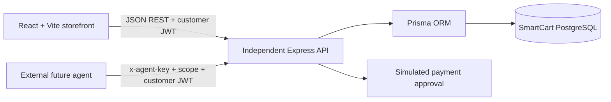

# SmartCart architecture

SmartCart is independently deployable. It contains no AI agent, travel, or event booking services. The API validates identity, scope, coupons, stock, order confirmation and idempotency. Order creation runs in a database transaction. Payment is simulated only.
